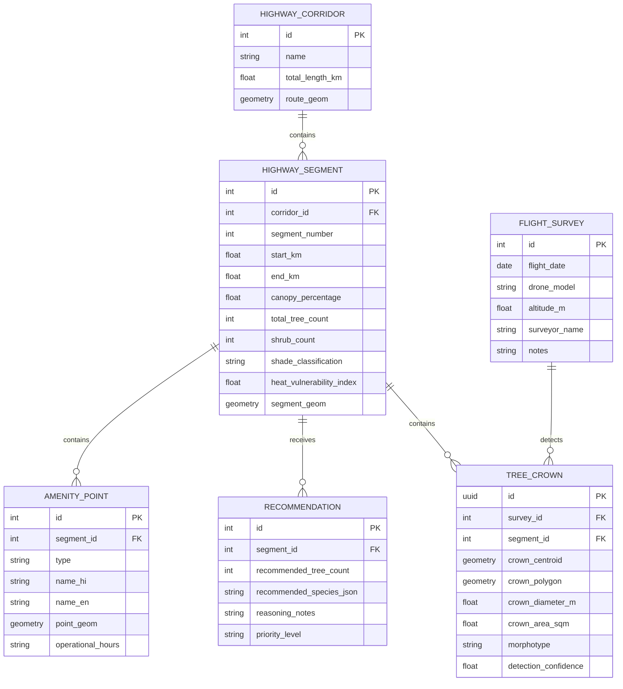

# System Architecture Document

## Project: GreenCorridor Ujjain
**AI-Based Tree Census, Green Cover Gap Analysis, and Shade Planning for the Ujjain–Indore Highway (Simhastha 2028)**  
**Document Version:** 1.0.0  

---

## 1. High-Level Architecture Overview

GreenCorridor Ujjain is organized into a modular, decoupled architecture consisting of **six foundational layers**:
1. **Data Ingestion & Preprocessing Layer:** Handles drone flight imagery, EXIF telemetry extraction, orthomosaic tiling, and coordinate transformation.
2. **AI Vision & Morphological Layer:** Performs crown detection (DeepForest / YOLOv8), boundary Non-Maximum Suppression (NMS), and crown morphotype classification.
3. **Geospatial & Spatial Analytics Layer:** Computes highway corridor buffering, $500\,\text{m}$ linear segment slicing, canopy coverage calculation, and gap identification.
4. **Explainable Recommendation Layer:** Applies deterministic urban forestry rules (Santamour 10-20-30 guideline) and Malwa native planting logic.
5. **API & Data Storage Layer:** FastAPI backend exposing REST/GeoJSON endpoints backed by GeoPackage / PostGIS spatial databases.
6. **Presentation Layer (Dual Client Frontends):**
   - **Officials' Analytics & Audit Dashboard:** Desktop-first GIS view for engineers and forestry officers.
   - **Pilgrim Shade & Help Map:** Mobile-first, low-bandwidth, bilingual (Hindi/English) Progressive Web App for devotees.

```mermaid
flowchart TD
    subgraph S1 [1. Ingestion & Preprocessing]
        A1[DJI Drone Photos / Orthomosaic] --> A2[EXIF & Telemetry Parser]
        A2 --> A3[Coordinate Reprojection EPSG:4326 to EPSG:32643]
        A3 --> A4[Sliding Window Tiler 640x640 px with 20% Overlap]
    end

    subgraph S2 [2. AI Vision & Inference Pipeline]
        A4 --> B1[Pretrained DeepForest Detector]
        B1 --> B2[Tile-Border Stitching & Spatial NMS]
        B2 --> B3[Crown Area & Centroid Computation]
        B3 --> B4[Crown Morphotype Classifier ResNet/EfficientNet]
        B4 --> B5[Class Strata: Mature Tree vs Median Shrub vs Bare Gap]
    end

    subgraph S3 [3. Geospatial Analytics & Spatial DB]
        B5 --> C1[Highway Centerline 70m Corridor Buffer]
        C1 --> C2[Linear Corridor Slicing 500m Segments]
        C2 --> C3[Canopy Coverage % & Tree Density Aggregator]
        C3 --> C4[Exploratory Carbon Sequestration Estimator]
        C4 --> C5[(GeoPackage / PostGIS Spatial Database)]
    end

    subgraph S4 [4. Explainable Rule Engine]
        C5 --> D1[Gap Threshold Evaluator Canopy < 8%]
        D1 --> D2[Santamour 10-20-30 Diversity Rule Check]
        D2 --> D3[Malwa Native Species Planting Matrix]
        D3 --> D4[Deterministic Planting Priority Ranking]
    end

    subgraph S5 [5. Backend API Services]
        C5 & D4 --> E1[FastAPI REST & GeoJSON Service]
        E1 --> E2[/api/segments/analytics]
        E1 --> E3[/api/crowns/geojson]
        E1 --> E4[/api/pilgrim/shade-map]
        E1 --> E5[/api/reports/export]
    end

    subgraph S6 [6. Dual Presentation Interfaces]
        E2 & E3 & E5 --> F1[Officials Analytics Dashboard<br>React + MapLibre / Leaflet]
        E4 --> F2[Pilgrim Shade & Help PWA<br>Bilingual Hindi/English Offline PWA]
    end
```

---

## 2. Pipeline Subsystems & Data Flow

### 2.1 Ingestion & Spatial Preprocessing Subsystem
- **Input Formats:**
  - Raw DJI Drone JPG images containing EXIF tags (`GPSLatitude`, `GPSLongitude`, `GPSAltitude`, `GimbalYawDegree`).
  - Stitched GeoTIFF orthomosaics generated from photogrammetry tools (OpenDroneMap / WebODM / Esri).
- **Processing Steps:**
  1. **Telemetry Extraction:** Python `exifread` / `Pillow` reads coordinates and camera focal length.
  2. **Ground Sampling Distance (GSD) Estimation:**
     $$\text{GSD} = \frac{\text{Flight Altitude} \times \text{Sensor Width}}{\text{Focal Length} \times \text{Image Width}}$$
  3. **Tiling Strategy:** Slices high-resolution imagery into $640 \times 640$ pixels with a $20\%$ overlap (stride $= 512$ px) to prevent slicing crowns directly along tile borders.
  4. **Projection Normalization:** Translates pixel coordinates $(x, y)$ to geographic coordinates:
     - WGS 84 (`EPSG:4326`) for web mapping.
     - UTM Zone 43N (`EPSG:32643`) for metric calculations (canopy area in $\text{m}^2$, segment distance in meters).

### 2.2 Deep Learning Crown Detection Subsystem
- **Model Framework:** DeepForest (RetinaNet with ResNet-50 Feature Pyramid Network backbone) or YOLOv8-OBB fine-tuned on drone aerial canopy data.
- **Inference Pipeline:**
  - Batch inference on image tiles ($640 \times 640$).
  - Detection confidence cutoff: $\tau_{\text{conf}} \ge 0.40$.
  - **Tile-Border Reconciliation (Spatial NMS):** Re-project bounding boxes into UTM global coordinates. Applies intersection-over-union (IoU) deduplication ($\text{IoU} > 0.45$) to consolidate duplicate crowns detected in overlapping adjacent tiles.

### 2.3 Morphotype & Vegetation Strata Classification
- **Classification Taxonomy:**
  1. `Class_Tree_Broadleaf`: Mature deciduous/evergreen broadleaf trees (*Azadirachta*, *Ficus*, etc.) — high shade efficiency.
  2. `Class_Tree_Palm_Narrow`: Tall narrow crowns, date palms (*Phoenix sylvestris*), or columnar trees — low shade footprint.
  3. `Class_Median_Shrub`: Flowering or boundary shrubbery planted along central medians (*Bougainvillea spectabilis*, *Nerium oleander*) — ground-level ornamental, zero pedestrian shade.
  4. `Class_Bare_Soil_Embankment`: Barren roadside shoulders, stone pitching, unplanted earthen gaps.
- **Model Architecture:** Lightweight CNN (MobileNetV3 / ResNet-18) operating on cropped bounding box patches to classify crown morphotypes.

### 2.4 Geospatial Corridor Segmentation & Gap Analysis
- **Corridor Geometry:**
  - Route alignment polyline: Ujjain to Indore highway (~45–55 km).
  - Corridor Polygon: Centerline buffered bilaterally by $35\,\text{m}$ (total swath: $70\,\text{m}$, encompassing lanes, paved shoulders, earthen verge, and outer tree lines).
  - Segmentation: Discretized along centerline into regular $500\,\text{m}$ linear bins ($S_1, S_2, \dots, S_N$).
- **Spatial Queries (GeoPandas / PostGIS):**
  - Point-in-polygon assignment of crown centroids to segments.
  - Aggregation of crown area ($\sum \text{Crown Area}$) per segment.
  - Calculation of Canopy Cover Index:
    $$C_{\text{cov}}(S_k) = \frac{\sum_{i \in S_k} \text{Area}(C_i)}{\text{Area}(S_k)} \times 100$$
  - Gap Identification: Segment is categorized as:
    - **High Shade Zone:** $C_{\text{cov}} \ge 25\%$ (Comfortable shade for pilgrims).
    - **Moderate Shade Zone:** $10\% \le C_{\text{cov}} < 25\%$.
    - **Critical Shade Gap:** $C_{\text{cov}} < 8\%$ (Extreme heat exposure, urgent planting priority).

### 2.5 Explainable Native Recommendation Engine
Instead of black-box unexplainable AI, a deterministic ecological rule engine produces recommendations understandable by public works and forestry officials:
- **Diversity Constraint (Santamour 10-20-30 Rule):**
  - Max $10\%$ of any single species.
  - Max $20\%$ of any single genus.
  - Max $30\%$ of any single family.
- **Native Malwa Species Selection Matrix:**
  - Top Roadside Shade Species: Neem (*Azadirachta indica*), Peepal (*Ficus religiosa*), Banyan (*Ficus benghalensis*), Karanj (*Millettia pinnata*), Mahua (*Madhuca longifolia*).
  - Embankment Soil Stabilizers: Bamboo clusters (*Dendrocalamus strictus*), Babool (*Vachellia nilotica*).
  - Discouraged / Water-Hungry Species: *Eucalyptus globulus*, *Conocarpus erectus*, *Prosopis juliflora*.
- **Capacity Formula:**
  $$\text{Planting Slots Available} = \max\left(0, \left(\frac{\text{Target Canopy Area} - \text{Current Canopy Area}}{\text{Average Mature Crown Area (approx. } 35\,\text{m}^2\text{)}}\right)\right)$$

---

## 3. Database Schema & Data Models

### 3.1 Entity Relationship Diagram



---

## 4. REST API Contract Overview

| Method | Endpoint | Description | Query Parameters / Payload | Response |
| :--- | :--- | :--- | :--- | :--- |
| `GET` | `/api/v1/corridor/segments` | List all 500m segments with canopy % and shade rating | `?min_gap=true&sort_by=priority` | GeoJSON FeatureCollection of segments |
| `GET` | `/api/v1/segments/{id}/crowns` | Retrieve individual detected crowns within a segment | `?class_filter=tree` | GeoJSON FeatureCollection of Point/Polygon |
| `GET` | `/api/v1/recommendations` | Get rule-based planting prescriptions for gaps | `?priority=high` | Array of segment prescription objects |
| `GET` | `/api/v1/pilgrim/amenities` | Simhastha water, medical, toilet points | `?lang=hi&type=all` | GeoJSON of pilgrimage assistance points |
| `POST` | `/api/v1/survey/ingest` | Upload new survey metadata or tile processing job | Multi-part form: flight metadata, GeoTIFF link | Job ID & initial status |
| `GET` | `/api/v1/reports/export` | Export segment summary for administrative review | `?format=csv\|geojson\|pdf` | File download stream |

---

## 5. Security, Resilience & Scalability

### 5.1 Deployment Architecture
- **Inference Workers:** Heavy deep learning jobs run asynchronously (Celery / Background Worker or Google Colab / Kaggle batch jobs) outputting spatial GeoJSON tables to avoid blocking the API server.
- **API Server:** Lightweight asynchronous FastAPI server containerized with Docker, deployable on minimal cloud instances or internal municipal servers.
- **Web Clients:** Static HTML5/CSS/JavaScript builds served over high-speed CDNs. The Pilgrim App utilizes service workers to cache tile maps and amenity databases for offline resilience during Simhastha network congestion.
