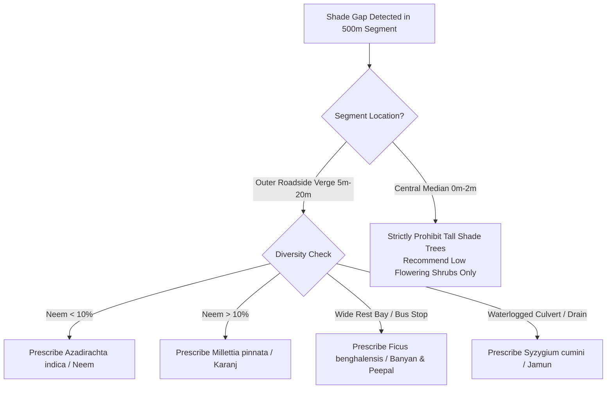

# Project Brain & Knowledge Repository

## Project: GreenCorridor Ujjain
**AI-Based Tree Census, Green Cover Gap Analysis, and Shade Planning for the Ujjain–Indore Highway (Simhastha 2028)**  
**Document Version:** 1.0.0  

---

## 1. Domain Context: Simhastha 2028 & Highway Realities

### 1.1 The Mega-Event (Simhastha Kumbh Mela)
- **Official Dates:** March 27 to May 27, 2028.
- **Location:** Ujjain, Madhya Pradesh (Shipra River Ghats, Mahakaleshwar Jyotirlinga, Panchkroshi Yatra circuit).
- **Scale:** An estimated **40 crore devotees** over the 2-month festival, with peak royal bath days (*Shahi Snan*) witnessing upwards of **3.5 to 4 crore pilgrims in a single 24-hour cycle**.
- **Government Vision:** *"Clean Simhastha, Healthy Simhastha, Green Simhastha"* under MP state infrastructure initiatives.

### 1.2 The Ujjain–Indore Highway Corridor
- **Length:** ~55 km total corridor (primary six-lane road expansion covering 44.6 to 46 km).
- **Widening Project:** Upgraded from a 4-lane ($17\,\text{m}$) carriageway to an expanded 6-lane ($25\,\text{m}$ carriageway + paved shoulders + earthen verge). Total project cost reported around ₹1,692 crore (with road construction packages totaling ~₹623.95 crore).
- **Traffic Growth:** Baseline traffic of ~25,000 vehicles/day projected to surge past 60,000+ vehicles/day, alongside immense waves of pedestrian yatris.
- **The Tree Deficit:** Permission granted to cut or transplant approximately **3,000 mature roadside trees** to widen the lanes. While the state has mandated planting **15 lakh saplings** across Ujjain division, past experience shows manual reporting suffers from severe attrition and zero coordinate-level tracking.

---

## 2. Microclimate & Thermal Physics of Shade

Highway asphalt is a massive thermal sink with low albedo ($0.05\text{--}0.15$), absorbing solar radiation during the day and re-radiating intense thermal energy. In April and May in the Malwa region:
- Ambient air temperature: $40^\circ\text{C}\text{--}45^\circ\text{C}$
- Exposed road asphalt surface temperature: **$48^\circ\text{C}\text{--}55^\circ\text{C}$**

### 2.1 Empirical Research Citations

| Research Study | Focus & Sample Size | Key Empirical Finding | Direct Highway Implication |
| :--- | :--- | :--- | :--- |
| **University of Manchester** *(Urban Forestry & Greening)* | Street tree shade effects on microclimate | Tree shade cut maximum surface temperatures by up to **$19^\circ\text{C}$**, and lowered globe temperature (human perceived heat) by **$5^\circ\text{C}\text{--}7^\circ\text{C}$**. | Pedestrians walking along shaded segments experience significantly lower heatstroke and cardiovascular stress. |
| **Free University of Bozen-Bolzano** *(332 crowns, 85 species)* | Tree traits on cooling efficiency | Median surface cooling of **$16.4^\circ\text{C}$ on asphalt** at western edge of tree shade. Cooling was strictly dependent on **crown width** and **Leaf Area Index (LAI)**. | Species selection matters: broadleaf spreading trees cool far more than thin columnar trees or small shrubs. |
| **Ohio State University** *(3D Shade Model)* | Microclimate simulation on 93.3°F day | Fully grown existing trees lowered ground surface temperature by **$3.5^\circ\text{F}$**; additional 20 mature trees reduced it by another **$1.4^\circ\text{F}$**. | Increasing canopy density from 5% to 25% produces immediate localized microclimate relief. |
| **Manchester Street-Tree Study** | Radiant temperature dynamics | Shade reduced mean radiant temperature by **$4^\circ\text{C}$** and asphalt surface temperature by **$12^\circ\text{C}$** on average. | Species with denser, multi-layered canopies offered superior cooling compared to sparse deciduous canopies. |

---

## 3. Computer Vision & Drone Remote Sensing Science

### 3.1 Why DeepForest over Generic Object Detectors?
Generic models (YOLOv8, Faster R-CNN) trained on MS-COCO are designed to identify objects with clear silhouettes and distinct vertical aspect ratios (cars, pedestrians, bicycles). In nadir (straight top-down) drone imagery:
- Tree crowns have irregular, amorphous boundaries with gradual texture transitions into grasses and agricultural crops.
- Shadows cast by crowns vary dynamically with sun angle and flight time.
- Crowns overlap and interlock.
- **DeepForest (Weinstein et al., 2020)** was pre-trained using weak supervision on over 30 million crowns across 22 forest ecologies and fine-tuned on 10,000 hand-annotated airborne RGB crowns. Using DeepForest provides a robust initial feature representation for aerial crowns that requires only light local calibration.

### 3.2 Drone Top-View Operational Realities & Limitations
1. **Visual Crown Morphotypes vs. Species:** Drone RGB photography captures the top canopy envelope. It cannot reliably distinguish subtle leaf venation, bark fissures, or floral buds. Thus:
   - Detections are grouped into **visual morphotypes** (Dense Broadleaf, Spreading, Columnar/Palm, Sparse).
   - Specific botanical labels (*Azadirachta indica*, *Ficus religiosa*) are only assigned when paired with ground-truth botanical waypoint GPS coordinates.
2. **Median Shrubs vs. Trees:** Highway medians in the drone imagery feature young, flowering shrubs (*Bougainvillea*, *Nerium*). These are botanically woody but provide $0\,\text{m}$ of pedestrian shade and have crown footprints $< 4\,\text{m}^2$. Our spatial classifier isolates them using highway median buffer masks.

---

## 4. Mathematical Formulations & Algorithms

### 4.1 Ground Sampling Distance (GSD)
$$\text{GSD}_{\text{cm/px}} = \frac{\text{Flight Altitude (m)} \times \text{Sensor Physical Width (mm)} \times 100}{\text{Focal Length (mm)} \times \text{Image Width (px)}}$$

### 4.2 Segment Canopy Cover Percentage ($C_{\text{cov}}$)
For each $500\,\text{m}$ linear segment $S_k$:
$$C_{\text{cov}}(S_k) = \left(\frac{\sum_{i \in S_k} \text{Area}(\text{Crown}_i)}{\text{Total Area}(S_k)}\right) \times 100$$
Where:
- $\text{Total Area}(S_k) = 500\,\text{m} \times 70\,\text{m} = 35,000\,\text{m}^2$ ($3.5\text{ hectares}$).

### 4.3 Santamour 10-20-30 Diversity Compliance Index
$$\text{DivScore} = \begin{cases} 1.0 & \text{if } \max_i(P_{\text{species}_i}) \le 0.10 \text{ and } \max_j(P_{\text{genus}_j}) \le 0.20 \text{ and } \max_k(P_{\text{family}_k}) \le 0.30 \\ 0.0 & \text{otherwise} \end{cases}$$

### 4.4 Indicative Aboveground Biomass & Carbon Sequestration
Following standard allometric urban forestry approximation models:
$$\text{Biomass (kg)} = a \times (\text{Crown Area in }\text{m}^2)^b$$
$$\text{Carbon Stock (tC)} = \text{Biomass} \times 0.47 \times 10^{-3}$$
*(Note: Displayed in the Officials' Dashboard clearly as an exploratory indicative planning estimate).*

### 4.5 Pilgrim Heat-Risk Index (HRI)
$$\text{HRI}(S_k) = \min\left(1.0, \max\left(0.0, 1.0 - \frac{C_{\text{cov}}(S_k)}{25.0}\right)\right)$$
- If $C_{\text{cov}} \ge 25\% \implies \text{HRI} \le 0.0$ (Cool / Plentiful Shade).
- If $C_{\text{cov}} = 5\% \implies \text{HRI} = 0.80$ (High Heat Stress).

---

## 5. Domain Rules for Species Selection in Malwa

