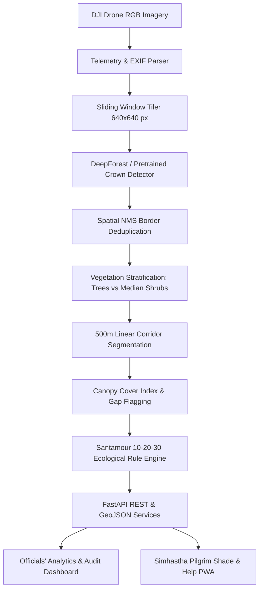

# GreenCorridor Ujjain 🌿🚁

> **AI-Based Tree Census, Green Cover Gap Analysis, and Shade Planning for the Ujjain–Indore Highway (Simhastha 2028)**

[](https://fastapi.tiangolo.com)
[](https://leafletjs.com)
[](https://python.org)
[](LICENSE)

---

## 📖 Overview

The **Ujjain–Indore Highway (SH-27 / NH upgrade, ~45–55 km corridor)** is being widened into a six-lane highway to prepare for **Simhastha Kumbh Mela 2028**, an event expected to draw over **40 crore devotees** between late March and late May 2028 under peak summer conditions ($>45^\circ\text{C}$). 

Road widening required removing or transplanting approximately **3,000 mature shade trees**. While the Government of Madhya Pradesh announced an ambitious afforestation target of **15 lakh trees**, authorities lack an objective, automated, and auditable system to monitor surviving canopy, detect shade voids, enforce ecological balance, and protect walking pilgrims from acute heat stress.

**GreenCorridor Ujjain** bridges this divide by turning high-resolution top-view drone imagery into an automated tree census, 500-meter segment canopy analytics, explainable native planting recommendations, and a bilingual mobile-first shade map.

---

## 🏛️ System Architecture



---

## 🌟 Key Features

### 1. 📊 Officials' Analytics & Audit Dashboard
- **Corridor Health Ribbon:** Total trees, median shrubs, average canopy coverage, critical gaps flagged, and estimated biomass carbon stock ($tC$).
- **Interactive GIS Map:** Multi-layer Leaflet GIS with 500m segment canopy choropleth (Green: $\ge 25\%$, Amber: $10\text{--}25\%$, Red: $< 10\%$).
- **Segment Inspection Drawer:** Instant drilldown on tree counts, species diversity breakdowns, and 1-click CSV audit export.
- **Explainable Native Recommendations:** Prescribes Malwa-indigenous shade trees (*Neem, Peepal, Banyan, Karanj, Jamun*) while strictly prohibiting invasive, water-draining species (*Eucalyptus, Conocarpus*).
- **Santamour 10-20-30 Rule Compliance:** Alerts civic officials when any single species exceeds $10\%$ dominance to prevent monoculture vulnerability.

### 2. ☀️ Pilgrim Shade & Help Map (*छाया एवं सेवा मित्र*)
- **Bilingual Interface:** Full native support for **English** and **Hindi (हिंदी)**.
- **Live Route Heat-Risk Bar:** 30 clickable blocks showing heat stress vs. shaded stretches between Ujjain (0 KM) and Indore (15 KM).
- **Quick Filters:** Filter by 🌳 छाया (Shade), 💧 शीतल जल (Cold Water), 🩺 चिकित्सा (First Aid), and 🏠 विश्राम (Rest Shelters).
- **Emergency Helpline:** Integrated speed-dial for 108 Ambulance and 112 Police assistance.

---

## 📂 Project Repository Structure

```text
├── ARCHITECTURE.MD      # System architecture, pipeline, ER diagram & API specs
├── Agent.md             # Sub-agent personas and pairing guidelines
├── BRAIN.md             # Domain intelligence, Simhastha 2028 context & thermal studies
├── Decisions.md         # Architecture Decision Records (ADR 001 - 008)
├── DESIGN.MD            # UI/UX design system, color tokens, and wireframes
├── PRD.md               # Complete Product Requirements Document
├── RULE.MD              # Development, geospatial, and urban forestry rules
├── TASK.MD              # Phased implementation roadmap and task tracking
├── TECHSTACK.MD         # Complete technology stack and dependency manifest
├── dataset/
│   ├── raw_frames/      # Top-view aerial drone sample imagery
│   └── geojson/         # Segment polygons, tree crowns, and amenities
├── scripts/
│   └── generate_mock_dataset.py  # Synthetic drone and geospatial data generator
├── src/
│   ├── preprocessing.py # Telemetry extraction & sliding window tiler
│   ├── detection.py     # Crown detection, spatial NMS & classification
│   ├── segmentation.py  # 500m corridor discretization & canopy metrics
│   ├── recommendation.py# Santamour 10-20-30 rule & native species logic
│   └── server.py        # FastAPI application backend
└── static/
    ├── index.html       # Dual-perspective responsive web application
    ├── style.css        # Emerald nature-tech stylesheet
    └── app.js           # Interactive GIS and bilingual client logic
```

---

## 🚀 Quickstart & Setup

### Prerequisites
- Python 3.10+
- Modern Web Browser (Chrome, Firefox, Edge)

### 1. Clone the Repository
```bash
git clone https://github.com/khushibarve25/Green-Corridor-Ujjain.git
cd Green-Corridor-Ujjain
```

### 2. Install Dependencies
```bash
pip install -r requirements.txt
```

### 3. Generate Mock Drone & Spatial Dataset
```bash
python scripts/generate_mock_dataset.py
```

### 4. Run the Prototype Server
```bash
python -m uvicorn src.server:app --port 8000 --host 127.0.0.1
```

Open your browser and navigate to:
👉 **`http://127.0.0.1:8000/`**

---

## 📜 Research Citations & Baseline Studies
- **DeepForest:** Weinstein et al., *Methods in Ecology and Evolution*, 2020.
- **Tree Shade & Cooling:** University of Manchester street tree study ($19^\circ\text{C}$ surface cooling; $5\text{--}7^\circ\text{C}$ globe temperature reduction).
- **Urban Forestry Diversity:** Frank S. Santamour 10-20-30 guideline.

---

## 👥 Authors & Acknowledgments
- **Project:** Minor Project for College Evaluation
- **Target Event:** Simhastha Kumbh Mela 2028, Ujjain, Madhya Pradesh
